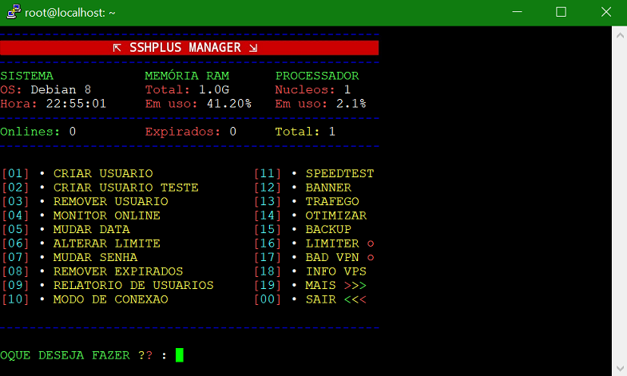

```
* UPDATE 07/11/2026 - projeto
* LCSSH MANAGER ( Versão Final 43)
```


# LCSSH MANAGER
É um script com um conjunto de funcionalidades e ferramentas adequadas para
oferecem extrema facilidade de uso em servidores Linux com foco no uso de
VPN, possui uma interface agradável fornecendo informações detalhadas sobre a máquina
e usuários...

## :book: Installation
```
apt-get update -y;
apt-get upgrade -y;
wget https://raw.githubusercontent.com/laecio96/LCSSH/master/Plus;
chmod 755 Plus; ./Plus
```
LCSSH MANAGER (dependências ausentes serão instaladas automaticamente)

## :scroll: Changelog
**VERSION: 43**
* **Projeto renomeado para LCSSH** por dentro e por fora: variáveis (`LCSSH_*`), caminhos (`/etc/LCSSH`, `/run/lcssh`, `/bin/lcssh`), tela do bot (`bot_lcssh`), textos das telas, imagem do README e URLs do repositório (`laecio96/LCSSH`)
* Todas as menções aos domínios e contatos de terceiros removidas do código — resta apenas o que é baixado deste repositório ou de fontes oficiais
* Correções e melhorias

**VERSION: 42**
* Temporários previsíveis em `/tmp` eliminados: todos os scripts passaram a usar um diretório privado do root (`/run/lcssh`, modo `700`), impedindo ataques de symlink/race por usuários locais
* `/etc/LCSSH` e `/etc/bot` agora ficam com permissão `700` — senhas em texto plano e dados do bot legíveis somente pelo root
* Conta de teste criada pelo bot recebe senha aleatória de 8 caracteres (antes era `1234` em todas as contas)
* Regras de firewall do slowdns adicionadas sem limpar as existentes (`iptables -F` removido); chave privada `server.key` gravada com `600`
* Domínio NS do slowdns validado antes de virar argumento do processo (sem injeção de argumentos)
* Senha digitada no menu `senharoot` não é mais exibida na tela; entrada oculta e limpeza da variável
* Arquivos mortos removidos (`Install/addIP`, `Install/senharoot.sh`, `Install/resolved.conf`); captura de IP via HTTPS
* Correções e melhorias

**VERSION: 41**
* Auditoria e limpeza de segurança: removidos `Modulos/cfirm.py` (exfiltração de credenciais), `Install/stunnel.pem` (chave privada compartilhada), bytecode morto (`GLTunnel_compiled.py`, `shadow_final.py`), `Install/_$_Url.txt` e `Install/sshd_config`
* Phone-homes eliminados: nenhum domínio ou IP de terceiros é mais usado — tudo é baixado deste repositório ou de fontes oficiais
* Certificado do SSL Tunnel gerado localmente na instalação (`openssl`), sem chave privada compartilhada
* ShellBot agora é baixado do repositório (cópia auditada) em vez do `master` mutável de terceiros
* Ofuscação morta do instalador removida, `chmod 777` corrigido para `755`, limpeza de histórico removida e detecção de IP por HTTPS
* Correções e melhorias

**VERSION: 40**
* Compatibilidade com Ubuntu e Debian atuais (Ubuntu 22.04/24.04, Debian 12/13)
* Proxy, WebSocket e Open convertidos para Python 3 (os SO atuais não trazem mais o Python 2)
* Squid instalado pelo pacote do próprio sistema, sem repositório antigo (trusty) nem `apt-key`
* Pacotes do instalador corrigidos (`python3-pip`, `net-tools`) e `speedtest-cli` com fallback automático
* Corrigido o módulo alterarsenha e o recarregamento do squid em addhost/delhost
* Correções e melhorias

**VERSION: 39**
* Suporte a arquiteturas ARM (ARM64/aarch64 e ARM 32 bits armhf)
* Detecção dinâmica de arquitetura na instalação e nos módulos
* badvpn-udpgw e SlowDNS (dnstt) são compilados automaticamente quando não há binário pronto para a arquitetura
* Correções e melhorias

**VERSION: 38**
* Websocket adicionado
* Correções e melhorias

## :book: How it works
* Conexão SSH
* Conexões Dropbear, SSLTunnel4, OpenVPN, etc.
* Excluir e criar usuários
* Monitor de conexão online
* Detalhes do seu sistema e usuários
* Ferramentas de digitalização e pesquisa
* Otimize e limpe o sistema e muito mais

## :heavy_exclamation_mark: Requirements
* Um sistema operativo baseado em Linux (Ubuntu ou Debian)
* Ubuntu 18.04, 20.04, 22.04 e 24.04 Server
* Debian 9, 10, 11, 12 e 13 Server
* **ARM**: ARM64 (aarch64) e ARM 32 bits (armhf/armv7) - VPS ARM, Oracle Cloud, Raspberry Pi 4/5 e SBCs
* A arquitetura é detectada automaticamente durante a instalação
* Recomendamos Debian 12/13 Server ou Ubuntu 22.04/24.04 Server
* Recomenda-se usar uma distribuição nova ou formatada
* O idioma padrão é o português

## :wrench: Arquiteturas suportadas
| Arquitetura | jq | badvpn-udpgw | SlowDNS |
| --- | --- | --- | --- |
| x86_64 | binário oficial | binário oficial | binário oficial |
| arm64 / aarch64 | pacote da distro | compilado no servidor | compilado no servidor (Go) |
| armhf / armv7 | pacote da distro | compilado no servidor | compilado no servidor (Go) |
| i386 | pacote da distro | compilado no servidor | compilado no servidor (Go) |

A detecção é feita em `Install/arch` (arquivo instalado em `/etc/LCSSH/arch`), que também valida se um binário já instalado serve para a arquitetura atual.

## :octocat: Credits
1. @laecioc96 - Developer of Plus Manager
2. LC96 Dev Team - Contributor 
```
☆ https://t.me/laecioc96 ☆
```
